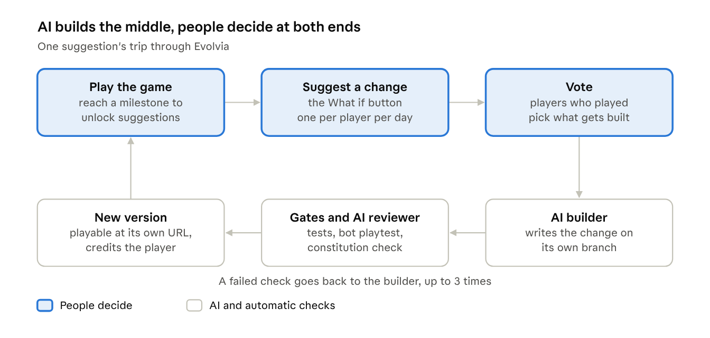

# Evolvia

*Play, create, evolve.*

Evolvia is a game that its players build. Play the current version, reach a milestone, and suggest a change ("What if…?"). Other players vote, AI agents build the best suggestions, automatic checks and a review make sure the game still works, and a few minutes later there is a new version to play. Every version stays playable, so the game grows into a tree of versions and can turn into something completely different.



It starts with no game at all: players propose game ideas, the AI builds small prototypes of the top ideas, everyone plays them and votes, and the winner becomes the first game.

A class project for Event Driven Programming at ATA. Every step is an event, so students can build their own services on top of it.

## Status

**Live:** https://evolvia.atabuilderslab.pl (sign in with GitHub to play). Design: [DESIGN.md](DESIGN.md).

| Phase | What | Status |
|-------|------|--------|
| 1 | Brainstorming with the class | done, 27 Nov 2026 |
| 2 | MVP: game template ✓, platform ✓ (login, milestones, ideas, votes), AI build pipeline ✓, Multiverse ✓, XP and levels ✓, idea and prototype rounds ✓ | done |
| 3 | Students play, suggest, vote and build event consumers | later |

## Repos

| Repo | What |
|------|------|
| `evolvia` (this one) | The platform: login, games, milestones, ideas, votes, event feed (builds and XP next) |
| [`evolvia-template`](https://github.com/pbrudny/evolvia-template) | Starting point for every game: rules contract, sample game, bot, gates, constitution |
| `evolvia-<slug>` | One repo per game (none yet) |

## The platform

FastAPI + SQLite, one app on two addresses:

- **https://evolvia.atabuilderslab.pl**: pages, GitHub login, the API, `/api/events` (the public event feed).
- **https://evolvia-play.atabuilderslab.pl**: only the files of game versions, shown in a sandboxed frame. No cookies, strict CSP, and the game page needs a short-lived ticket that the platform gives to signed-in players.

```bash
uv sync
uv run pytest                                   # tests (no network)
DATA_DIR=./data uv run uvicorn evolvia.server:app --port 8000
# then open http://127.0.0.1:8000 (platform) — the play address defaults to http://localhost:8000
```

Admin (on the server: `docker exec <container> evolvia-admin ...`):

```bash
evolvia-admin add-game --game spark-run --name "Spark Run" --repo pbrudny/evolvia-template
evolvia-admin add-version --game spark-run --ref <branch|sha> --changelog "..." --credit <login> [--main]
evolvia-admin set-main --game spark-run --version spark-run-abc1234
evolvia-admin xp --login alice --points 10 --reason bug   # bug +10, prototype +50, rollback -20, manual
evolvia-admin list
```

## XP and levels

XP follows DESIGN.md §10. It is awarded automatically: +5 for the first milestone on a version, +1 when someone votes for your idea, +30 when it goes live, and +1 for each new player on your version (max 50). Bugs, prototype rounds and rollbacks are awarded by hand with `evolvia-admin xp`. Every award is a row in the append-only `xp` table and an `XpAwarded` event (`LevelReached` on a level-up).

Current XP loses 20% per month, lifetime XP never does. The level comes from current XP and sets ideas per day: Player 1 (after the first milestone); Contributor (20) 2; Builder (100) 3 and +3 votes on new ideas; Architect (300) 4; Curator (600) 4 and double votes.

Pages: `/p/<login>` (level, XP history, live ideas), `/g/<slug>/tree` (the Multiverse). Admins: `/admin/xp.csv` (login, name, level, current, lifetime, live ideas, confirmed bugs). Names come from an optional `DATA_DIR/roster.json` (`{"github-login": "Student Name"}`).

### Runs on the Claude subscription

The worker calls `claude -p` with Piotr's claude.ai subscription login (`CLAUDE_CONFIG_DIR`, default `~/.claude`), never an API key: it removes `ANTHROPIC_API_KEY`/`ANTHROPIC_AUTH_TOKEN` from the agents' environment and skips a poll unless `claude auth status` says `authMethod: claude.ai`. Builds count toward the subscription's usage limits; the dollar amounts in the log are estimates only.

## Slack: #evolvia

Channel `#evolvia` in the EDP Slack workspace (all students are members). `src/evolvia/notify.py` is an event consumer: it reads `/api/events` after a saved cursor (`~/.evolvia-worker/slack.json`) and posts as Piotr (`SLACK_EDP_USER_TOKEN`): a new idea as a channel message; its decision (sent to the builder / rejected with the reason / failed) and the new version (changelog + play link, also sent to the channel) in the idea's thread; plus idea rounds, prototypes, new games, merges and main-version changes. Player text is escaped. The worker runs it on every poll; by hand: `uv run evolvia-worker notify [--dry-run]`.

## Merging versions

In the Multiverse (`/g/<slug>/tree`) an admin ticks 2–4 versions and clicks **Merge selected**. The worker merges their commits one by one on a branch `merge/<id>` (the first ticked version is the base and becomes the parent), the builder resolves conflicts with every version's changelog in hand, then the usual gates and reviewer run. The new version shows "Merged from …" in the tree, and its closing commit credits every idea's author with `Co-authored-by`. A failed merge can be retried.

## Idea rounds and prototype rounds

`/rounds` (DESIGN.md §4.1–4.2). An admin or an Architect opens a round with two lengths: hours for ideas, hours to play and vote.

1. **Ideas.** Players post one game idea per round to the shared idea board and upvote others (+1 XP per vote to the author).
2. **Prototypes.** When the idea phase ends, the top 3 ideas on the board are queued. The worker builds each from `evolvia-template` on a branch `prototype/<idea>-<login>` of [`pbrudny/evolvia-prototypes`](https://github.com/pbrudny/evolvia-prototypes) (same classifier → builder → gates → reviewer loop, with a prototype note). Each prototype is a hidden game `proto-<idea>`, playable at `/g/proto-<idea>`, without "What if…?".
3. **Play and vote.** One vote per player per round, only for a prototype in which the player reached a milestone.
4. **The winner becomes a game.** The most-voted prototype wins (+50 XP to its author). The worker creates the public repo `pbrudny/evolvia-<slug>` with the prototype commit as `main`, and the platform installs it as version 0. Ideas that didn't win go back to the board.

Phases move on by time (checked on every round page and worker poll). Admins can end a phase early ("End this phase now") and retry a failed prototype. Keep `evolvia-prototypes` `main` in sync with the template when the template changes.

## The build pipeline

An admin clicks **Build this** on an idea (or `evolvia-admin accept --suggestion N`). The build worker, running on a machine with the `claude` CLI, git, gh and Docker, picks it up:

```bash
EVOLVIA_WORKER_TOKEN=... uv run evolvia-worker run [--once]      # build accepted ideas from the platform
uv run evolvia-worker try --repo pbrudny/evolvia-spark-run --title "..."  # build an idea locally, no platform, no push
```

1. **Classifier** (no tools): is the idea about this game, safe, and within the constitution? A rejection reason is shown to the player.
2. **Builder** (may only read and edit files, no shell) changes the game on branch `suggestion/<id>-<login>`. Edits to protected files (`game/platform.js`, `gates.mjs`, `constitution.md`, ...) are undone.
3. **Gates** run in `docker run --network none` (limited CPU, memory, time): AI-written code never runs on the worker machine itself. Up to 3 rounds with the failure output fed back.
4. **Reviewer** (read-only) checks the diff against the idea and the constitution. Up to 2 rounds.
5. The commit credits the player (`Co-authored-by`), the branch is pushed, and the platform installs it as a new version with the changelog. An admin makes it the main version.

Agents run as `claude -p` with `--setting-sources ""`, `--strict-mcp-config` and an explicit tool list, so no user settings, hooks, MCP servers or CLAUDE.md reach them. A typical build takes 2–3 minutes and about $0.50.

Settings: `BASE_URL`, `PLAY_URL`, `GITHUB_CLIENT_ID`, `GITHUB_CLIENT_SECRET`, `SESSION_SECRET`, `ADMIN_LOGINS`, `AUTO_BUILD_MIN_VOTES` (default 2), `AUTO_BUILDS_PER_DAY` (default 5), `WORKER_TOKEN`, `DATA_DIR` (default `/data`).

## Credits

Name and slogan by [rayanhasasneh](https://github.com/rayanhasasneh). The ideas from EDP students that shaped the design are listed in [DESIGN.md §16](DESIGN.md#16-student-suggestions-phase-1).
